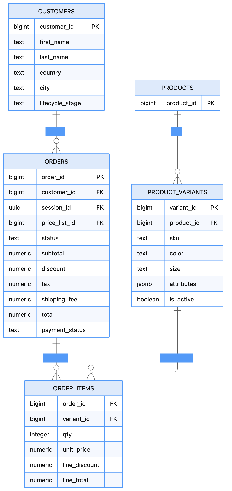
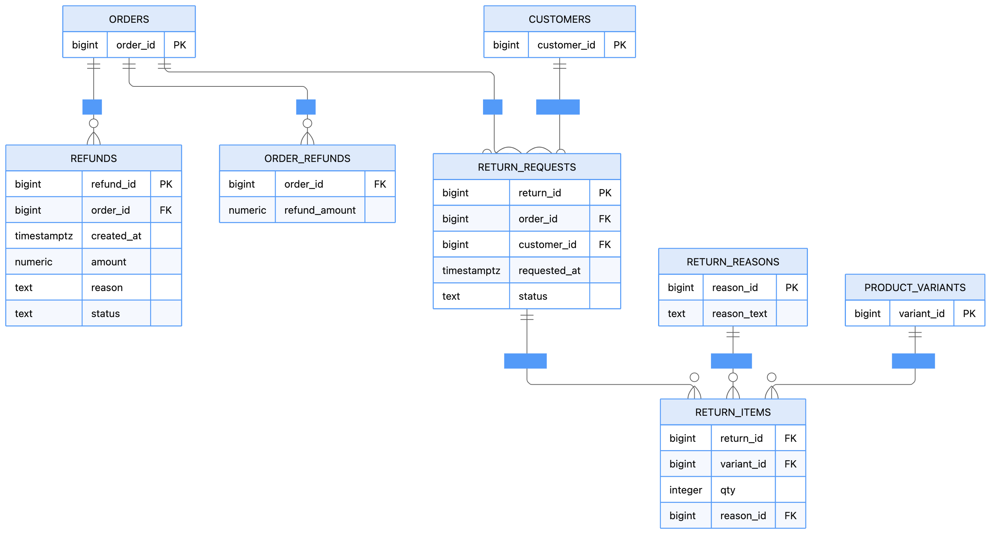

# Product Performance Analysis

## Monthly Revenue Trends and Month-over-Month Growth

### Business Question
How did monthly revenue from currently delivered orders change over time, and was the change associated with order volume or average order value?

### Methodology
- Grouped orders by creation month using `DATE_TRUNC()`.
- Filtered for orders whose current status is `delivered`.
- Calculated monthly revenue, order count, and average order value (AOV).
- Used `LAG()` to retrieve the previous month's revenue and calculate month-over-month (MoM) revenue growth.

### Key Findings

| Month | Delivered Orders | Revenue | MoM Revenue Growth | Average Order Value |
|---|---:|---:|---:|---:|
| March 2026* | 4,762 | 35,704,481.44 | — | 7,497.79 |
| April 2026 | 8,718 | 66,617,965.02 | +86.58% | 7,641.43 |
| May 2026 | 5,104 | 38,047,632.66 | -42.89% | 7,454.47 |
| June 2026* | 1,395 | 10,048,158.54 | -73.59% | 7,202.98 |

*March covers March 16–31; June covers June 1–14.*

- **April recorded the highest revenue:** Revenue increased by 86.58% from March to April, reaching 66.62 million. Delivered-order volume rose from 4,762 to 8,718, while AOV increased modestly from 7,497.79 to 7,641.43.
- **Revenue declined sharply in May:** Revenue fell by 42.89% to 38.05 million, while delivered-order volume decreased by approximately 41.5%. AOV declined by only about 2.4%, indicating that lower order volume was more closely associated with the revenue decline than a substantial change in average order value.
- **June shows a further decline, but the month is incomplete:** Revenue was 10.05 million across 1,395 orders through June 14. The reported 73.59% decline is not a like-for-like monthly comparison because June contains only 14 days of data.

### Business Interpretation
April was the strongest month in the observed period, followed by a substantial decline in May. The relative stability of AOV between April and May, compared with the reduction in order volume, suggests that order volume was the more prominent factor associated with the revenue decline.

This pattern warrants further investigation into customer ordering activity and fulfillment performance. The analysis identifies an observed trend but does not establish its cause.

### Limitations
- March and June are partial months; their MoM growth rates should not be interpreted as directly comparable full-month performance.
- Orders are grouped by `created_at` and filtered by their current status of `delivered`. The results represent orders currently marked delivered, grouped by creation month—not revenue grouped by actual delivery date.
- The data covers a limited period, so the observed decline should not be treated as proof of a sustained long-term trend.

## Revenue Trends: Fixed 14-Day Periods

### Business Question

How did revenue and delivered-order volume change across consecutive 14-day periods?

### Methodology

Used PostgreSQL's DATE_BIN() to group orders into fixed 14-day intervals, anchored at March 16, 2026.

Filtered orders by their current status of delivered.

Aggregated order count and revenue for each interval.

Used LAG() to compare each period's revenue with the preceding period and calculate percentage growth.
### Key Findings

|14-Day Period|Delivered Orders|Revenue|Revenue Growth|
| Mar 16–30, 2026 | 4,263 | 31,695,163.60 | — |
| Mar 30–Apr 13, 2026 | 5,256 | 40,170,749.36 | +26.74% |
| Apr 13–27, 2026 | 3,271 | 25,007,725.06 | -37.75% |
| Apr 27–May 11, 2026 | 2,502 | 19,125,123.80 | -23.52% |
| May 11–25, 2026 | 2,176 | 16,226,430.64 | -15.16% |
| May 25–Jun 8, 2026 | 1,916 | 13,649,299.90 | -15.88% |
| Jun 8–22, 2026 | 595 | 4,543,745.30 | -66.71% |

*Period end timestamps are exclusive boundaries. For example, the period beginning March 16 ends at March 30 at 00:00 UTC.*

### Business Interpretation

- **Initial increase:** Revenue increased by 26.74% in the period beginning March 30, reaching 40.17 million.
- **Sustained decline:** Revenue subsequently declined in each reported period, falling by 37.75% in the period beginning April 13 and continuing to decrease through the period beginning June 8.
- **Order volume followed a similar pattern:** Delivered-order counts peaked at 5,256 in the second period and declined in each subsequent period.
- **Incomplete final period:** The dataset ends on June 14, while the final 14-day interval ends on June 22. Therefore, the last period is incomplete and its revenue and order count should not be directly compared with those of full 14-day periods.

### Limitations

- The analysis groups orders by `created_at` and filters on their current status of `delivered`. It therefore measures revenue from orders currently marked delivered, grouped by order creation date—not revenue by actual delivery date.
- The final period is incomplete, which contributes to its lower reported revenue and order count.
- These results identify a downward trend in the observed data but do not establish its cause. Further investigation would be needed to distinguish changes in demand from fulfillment timing, data coverage, or other factors.

### Business Question

Which products generate the highest gross realized revenue from delivered orders, and how does revenue compare with units sold and order reach?

## SQL Approach
Joined orders, order_items, product_variants, and products.
Used order_items.line_total to calculate product-level sales value instead of orders.total, which could duplicate order-level revenue across multiple items.
Standardized order status using LOWER(TRIM(status)).
Restricted the analysis to delivered orders so that revenue represents completed sales.
Calculated:
Gross realized revenue
Units sold
Number of distinct orders
Average revenue per unit

Gross realized revenue represents sales from delivered orders before refunds. It is not equivalent to net revenue or profit.

## Key Findings
1. Marigold Home Craft Lite Wireless Earbuds generated the highest realized revenue

Marigold Home Craft Lite Wireless Earbuds ranked #1 with:

566,678 gross realized revenue
22 units sold
18 orders
25,758.09 average revenue per unit

It generated the highest revenue despite relatively low unit volume, indicating that its revenue contribution is driven more by higher value per unit than by high sales volume.

2. Zyra Bass+ Over-Ear Headphones is the strongest volume-driven product

Zyra Bass+ Over-Ear Headphones sold the most units among the top 10:

45 units
33 orders
446,955 gross realized revenue
9,932.33 average revenue per unit

This contrasts with Marigold: Zyra achieves substantial revenue through higher unit and order volume, rather than a high revenue per unit.

This is an important distinction:

Revenue leadership and volume leadership are not the same thing.

3. Mirae Essentials Luxe Smartwatch has the highest revenue per unit

Mirae Essentials Luxe Smartwatch generated:

423,489 revenue
from only 11 units
across 8 orders
at 38,499 revenue per unit

It has the highest average revenue per unit among the top 10 products, yet ranks only #9 by total revenue.

This suggests a high-value, low-volume product profile.

## Business Interpretation

The top products show that product performance is driven by different combinations of price/value, unit volume, and order reach.

High-value products can generate substantial revenue without selling large quantities.
High-volume products can generate strong revenue through greater unit and order volume.
Therefore, ranking products by revenue alone does not fully explain their commercial performance.

This distinction can support different business decisions around pricing, promotions, merchandising, and inventory planning.

However, this analysis does not establish profitability, because product costs, discounts, and refunds have not been incorporated.

4. Product reach also differs substantially

The number of distinct orders provides another perspective.

For example:

Product	Revenue	Units	Orders	Revenue / Unit
Marigold Earbuds	566,678	22	18	25,758
Zyra Headphones	  446,955	45	33	9,932
Mirae Smartwatch	423,489	11	8	38,499

So these products represent three different performance models:

Marigold: high revenue + high value per unit
Zyra: high volume + broad order reach
Mirae: very high value per unit + low volume

## Limitations & Next Steps
-Assess refunds on delivered orders and determine the extent to which refunds reduce realized revenue.
-Calculate net realized revenue after refunds at the order/customer/country level where the refund data can be reliably linked.
-Avoid assigning order-level refunds directly to individual products unless a reliable product-level refund relationship is available.
-Analyze the open-order pipeline separately, including non-cancelled, non-delivered orders, to identify products with strong current demand that have not yet contributed to realized revenue.
--Compare product performance with inventory levels to identify potential stock-out or overstock risks.
-Analyze product performance by category and brand to identify broader product-market patterns.
-Verify whether line_total incorporates discounts, promotions, taxes, or other adjustments before interpreting it as revenue.
-Assess profitability separately using product cost data, since revenue does not indicate margin or profit.

## High-Revenue vs. High-Volume Product Analysis

### Business Question
Which products generate the highest revenue, and which products sell the most units? Do the same products lead in both categories?

### SQL Approach
- Calculated gross revenue and total units sold for each product using delivered orders.
- Ranked products separately by gross revenue and sales volume using `DENSE_RANK()`.
- Classified products into three profiles based on whether they ranked in the top 10 for revenue, volume, or both:
  - High Revenue & High Volume
  - High Revenue & Low Volume
  - Low Revenue & High Volume

### Key Findings

**1. High Revenue & Low Volume**

- **Marigold Home Craft Lite Wireless Earbuds** ranked **1st in revenue** with gross revenue of **566,678** from **22 units**, but ranked 31st by sales volume.
- **Mirae Essentials Luxe Smartwatch** ranked 9th in revenue, generating **423,489** from just **11 units**, while ranking 42nd by volume.

These products generate substantial revenue despite relatively low unit sales, suggesting higher revenue per unit may contribute to their revenue rankings.

**2. High Revenue & High Volume**

- **Zyra Bass+ Over-Ear Headphones** ranked 6th in revenue and 8th in volume, generating **446,955** from **45 units sold**.

This product performs strongly on both measures, demonstrating that a product can combine high revenue with high sales volume.

**3. Low Revenue & High Volume**

- **Loom & Ladle Air Over-Ear Headphones** ranked 3rd in volume, selling **52 units**, but ranked 108th in revenue, generating **167,948**.
- **Anvi House Everyday Sunglasses** ranked 1st in volume, selling **57 units**, but ranked 506th in revenue, generating **64,393**.

These products sell many units but contribute comparatively less revenue, making their revenue contribution worth examining alongside sales volume.

### Business Interpretation

Revenue and volume rankings highlight different aspects of product performance. Products with high revenue but lower volume may benefit from their higher revenue per unit, while products with high volume but lower revenue may have lower revenue per unit.

The high-revenue, high-volume profile identifies products that perform well across both measures. These distinctions can help prioritize further investigation into product pricing, sales strategies, and product-level performance.

### Limitations and Next Steps

- **Profitability:** Revenue and sales volume do not establish profitability. Product costs and operating expenses would be needed to assess profit contribution.
- **Pricing analysis:** Compare revenue per unit across product profiles to understand differences in revenue contribution.
- **Inventory analysis:** Compare sales volume with inventory availability to identify potential stock shortages or slow-moving products.
- **Scope:** The classifications use a top-10 rank threshold for revenue and volume and include only delivered orders. They do not represent a complete segmentation of all products into high- and low-performing groups.

### Top 10 Customers by Net Realized Revenue

### Business Question  
Q: Which customers generate the highest net realized revenue after accounting for refunds?

### Key Findings  
Shreya Menon is the highest-value customer, generating $665,147.72 in net realized revenue from $673,757.00 gross realized revenue, with $8,609.28 in refunds. The remaining top customers generated between approximately $506K and $590K in net realized revenue.

One particularly useful observation is that 6 of the top 10 customers had no refunds, while the highest-ranked customer had the largest absolute refund amount. That doesn't necessarily mean Shreya is a problematic customer—the refund rate is only about 1.28%—but it is worth monitoring.

## Country-Wise Revenue and Refund Analysis

### Business Question
How is net realized revenue distributed across countries, and how do refunds compare with gross revenue in each geographic market?

### Methodology
- Joined customer, order, order-item, and refund data to calculate country-level revenue and refunds.
- Included orders currently marked as `delivered`.
- Standardized missing or unavailable country values, including `NULL`, blank strings, `N/A`, and `Not Available`, into a single `Not Available` category.
- Calculated gross revenue, total refunds, net realized revenue, and the revenue refund rate.

### Key Findings

| Country | Gross Revenue | Total Refunds | Net Realized Revenue | Revenue Refund Rate |
|---|---:|---:|---:|---:|
| India | 95,486,619.00 | 891,287.70 | 94,595,331.30 | 0.93% |
| United States | 17,654,096.00 | 132,023.64 | 17,522,072.36 | 0.75% |
| Not Available | 14,268,964.00 | 127,943.43 | 14,141,020.57 | 0.90% |

### Key Insights

- **India is the dominant revenue market:** India generated 94.60 million in net realized revenue, substantially exceeding the United States at 17.52 million.
- **Unavailable country data represents material revenue:** The `Not Available` group contributed 14.14 million in net realized revenue. Excluding these records would understate reported revenue and obscure a meaningful portion of the business.
- **Refund rates are relatively low across the reported groups:** Refunds represented 0.93% of gross revenue in India, 0.75% in the United States, and 0.90% for the unavailable-country group.
- **India has the highest observed refund rate:** Its rate is 0.18 percentage points above the United States. This difference is descriptive and does not establish why refund rates differ.

### Business Interpretation
India is the largest revenue market in the observed dataset. The unavailable-country group is also commercially significant, highlighting a data-quality issue worth addressing. Improving country-data completeness would enable more reliable geographic segmentation and more informed market-level decisions.

The observed refund rates can help prioritize further investigation, but they should not be interpreted as evidence of differences in customer satisfaction or product quality without additional analysis.

### Limitations
- The analysis includes orders currently marked as `delivered` and groups them by customer country.
- The `Not Available` category combines records with missing or placeholder country values; these records cannot be attributed to a specific geographic market without further data cleaning or enrichment.
- Refunds include records whose status is not `failed`. If this includes initiated but incomplete refunds, the reported refund totals may exceed completed refunds.
- Revenue refund rate is calculated as total refunds divided by gross revenue; it is not the percentage of orders that were refunded.

## Overall Realized Revenue After Refunds

### Business Question

How much revenue was generated from delivered orders, and how much remained after accounting for refunds?

### SQL Approach

- Filtered orders to `delivered` status using `LOWER(TRIM(status))`.
- Calculated gross realized revenue using `SUM(order_items.line_total)`.
- Aggregated refund amounts from the `refunds` table, excluding records with a `failed` status.
- Calculated net realized revenue by subtracting refunds from gross realized revenue.
- Calculated the revenue refund rate as total refunds divided by gross realized revenue, multiplied by 100.

### Key Findings

The analysis returned the following results:

| Metric                 |          Value |
| ---------------------- | -------------: |
| Gross realized revenue | 127,409,679.00 |
| Total refunds          |   1,151,254.77 |
| Net realized revenue   | 126,258,424.23 |
| Revenue refund rate    |          0.90% |

### Business Interpretation

The initial results show gross realized revenue of 127.41 million and net realized revenue of 126.26 million after subtracting the reported refunds. The reported revenue refund rate is 0.90%, indicating that refunds account for a relatively small share of gross realized revenue.

This metric provides a view of revenue retained after refunds and complements product and customer performance analyses. It can also serve as a baseline for investigating refund patterns across countries, customers and products.

### Limitations and Next Steps

- Treat net realized revenue as a revenue measure, not profit, because product costs and other operating expenses have not been deducted.
- Analyze refund patterns by customer and country to identify where refunds have the greatest financial impact.

## Product Analysis: Revenue in the Order Pipeline

### Business Question
Which products account for the highest value of orders that have not yet reached a delivered or cancelled status?

### Methodology
- Joined `orders`, `order_items`, `product_variants`, and `products` to calculate product-level pipeline metrics.
- Excluded orders currently marked `delivered` or `cancelled`, retaining the remaining order statuses.
- Aggregated order-item revenue, units sold, and distinct order counts by product.
- Ranked products by pipeline revenue to identify the ten products with the highest value in the current order pipeline.

### Key Findings

- **Eastlight Clarity ANC Headphones ranked first**, with pipeline revenue of 494,171 across 29 units and 24 orders.
- **Smartwatches and headphones featured prominently** among the top ten products, suggesting that both product types account for substantial value in the orders currently being processed.
- **Marigold Home Craft Lite Wireless Earbuds** contributed 323,586 in pipeline revenue from 14 units across 12 orders. Its relatively high revenue alongside lower unit volume illustrates why revenue rankings and volume rankings can differ.
- **Pipeline value was distributed across multiple products:** the tenth-ranked product, TickTone Essentials Vital Smartwatch, accounted for 296,982 across 18 units and 14 orders.

### Business Interpretation
The products with the highest pipeline revenue represent areas where order fulfillment may have a meaningful impact on future delivered sales. Monitoring these products can help prioritize fulfillment reviews and identify where delays could affect the conversion of pending orders into completed sales.

However, pipeline revenue is not realized revenue. These orders may still be in different stages of processing, and some may eventually be cancelled or otherwise fail to reach delivery. The analysis identifies current pipeline exposure, not guaranteed future revenue.

### Limitations
- Pipeline revenue is based on orders' current statuses at the time of analysis. It is a snapshot and does not show how long orders have remained in the pipeline.
- The analysis excludes currently delivered and cancelled orders, but combines the remaining statuses rather than comparing them separately.
- The query does not establish whether the orders will eventually be delivered. Historical order-status data would be needed to study transitions from pipeline statuses to delivered or cancelled outcomes.
- Pipeline revenue should be reported separately from delivered revenue to avoid presenting pending order value as realized sales.
